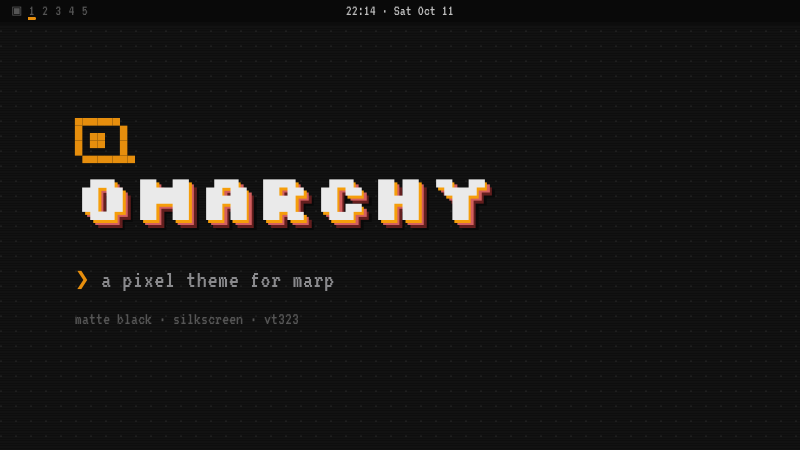
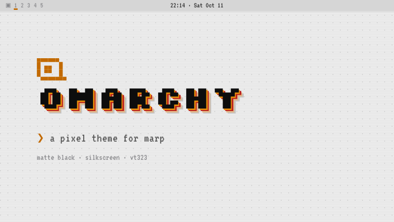
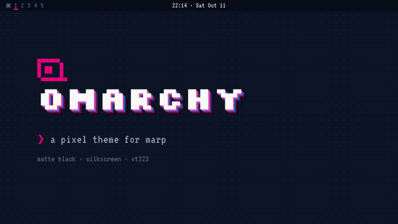
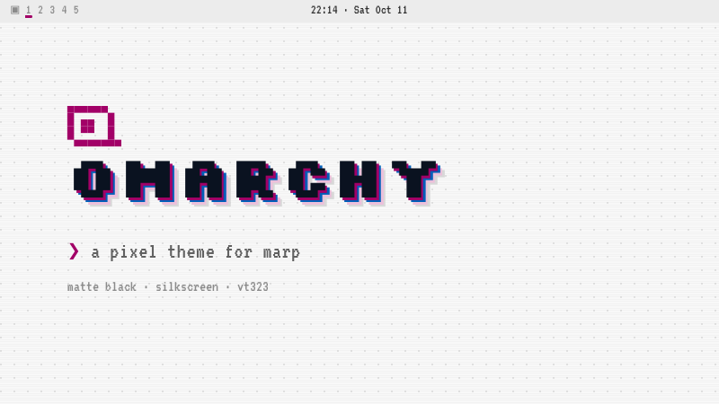
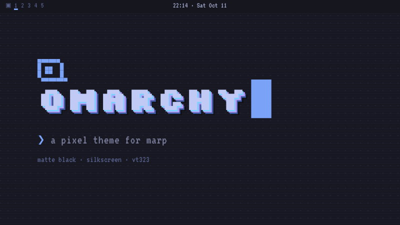
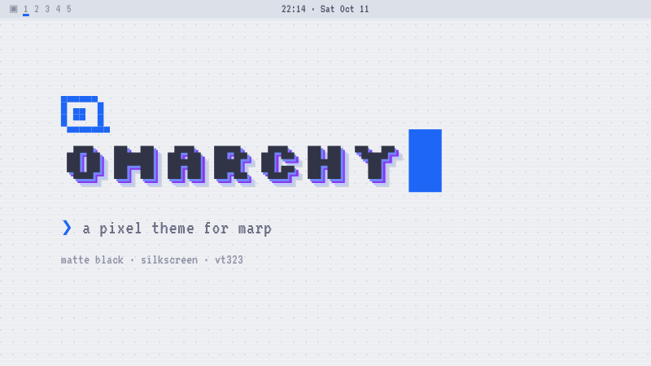

# omarchy-pixel — Marp themes

Pixel-look [Marp](https://marp.app) themes inspired by [Omarchy](https://omarchy.org) (Matte Black): blocky fonts, notched pixel borders, hard drop shadows, a Waybar-style top bar and Hyprland-style windows. Fonts are embedded as Base64, so every theme is a single self-contained CSS file.

## Demos

Click a preview to open the full demo deck as PDF (12 slides, every class).

| | |
| --- | --- |
| [](Omarchy%20Pixel%20Demo.pdf)<br>`omarchy-pixel` | [](Omarchy%20Pixel%20Light%20Demo.pdf)<br>`omarchy-pixel-light` |
| [](Omarchy%20Pixel%20French%20Purple%20Demo.pdf)<br>`omarchy-pixel-french-purple` | [](Omarchy%20Pixel%20French%20Purple%20Light%20Demo.pdf)<br>`omarchy-pixel-french-purple-light` |
| [](Omarchy%20Pixel%20Tokyo%20Night%20Demo.pdf)<br>`omarchy-pixel-tokyo-night` | [](Omarchy%20Pixel%20Catppuccin%20Latte%20Demo.pdf)<br>`omarchy-pixel-catppuccin-latte` |

## Themes

| Theme | File | Look |
| --- | --- | --- |
| `omarchy-pixel` | `MarpThemes/omarchy-pixel.css` | Matte Black, orange accent (base theme) |
| `omarchy-pixel-light` | `MarpThemes/omarchy-pixel-light.css` | Light paper, darkened orange |
| `omarchy-pixel-french-purple` | `MarpThemes/omarchy-pixel-french-purple.css` | Navy + magenta |
| `omarchy-pixel-french-purple-light` | `MarpThemes/omarchy-pixel-french-purple-light.css` | Light grey + magenta |
| `omarchy-pixel-tokyo-night` | `MarpThemes/omarchy-pixel-tokyo-night.css` | Tokyo Night (Omarchy default), blue accent |
| `omarchy-pixel-catppuccin-latte` | `MarpThemes/omarchy-pixel-catppuccin-latte.css` | Catppuccin Latte, blue accent |

All variants `@import 'omarchy-pixel'` and only swap the palette, so the base theme must always be loaded alongside them.

## Usage

**Obsidian ([Marp Slides](https://github.com/samuele-cozzi/obsidian-marp-slides)):** copy `MarpThemes/` into your vault and set the plugin's theme path to `MarpThemes`. Reopen the preview after adding new theme files.

**marp-cli:**

```bash
npx @marp-team/marp-cli --theme-set MarpThemes/ "Omarchy Pixel Demo.md"
```

Front matter:

```yaml
---
marp: true
theme: omarchy-pixel
paginate: true
header: 'centered in the bar'
footer: 'bottom left'
---
```

## Slide classes

Set per slide with `<!-- _class: name -->` or for the whole deck with `class: name`. Classes can be combined, e.g. `split small`.

| Class | Effect |
| --- | --- |
| `lead` | Title slide with pixel-art logo and extruded block lettering |
| `section` | Chapter divider; `# 01` becomes a huge outline number |
| `terminal` | Hyprland window with accent border and `❯` prompt |
| `split` | Two columns; `h1`/`h2` span both |
| `invert` | Inverted colors (light in dark themes, dark in light themes) |
| `small` / `tiny` | Shrink only the code blocks (16px / 13px) |
| `no-workspaces` | Hide the logo and workspace marker in the top bar |

The demo decks (`Omarchy Pixel * Demo.md`, rendered as `.pdf`) show every class. Design notes (German) are in `Omarchy Pixel Theme – Notizen.md`.

## Credits & licenses

- Omarchy Matte Black, Tokyo Night and Catppuccin palettes from [basecamp/omarchy](https://github.com/basecamp/omarchy).
- Embedded fonts, all under the SIL Open Font License 1.1 (see `fonts/`): [Silkscreen](https://github.com/googlefonts/silkscreen), [VT323](https://fonts.google.com/specimen/VT323), [JetBrains Mono](https://github.com/JetBrains/JetBrainsMono).
